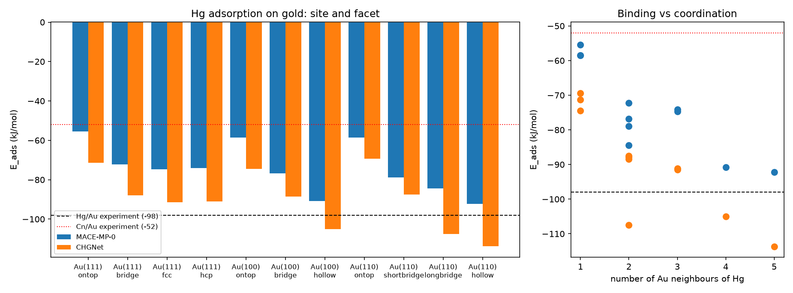

# Hg adsorption on gold surfaces with machine-learned interatomic potentials (ASE)

Mercury is the lighter homolog of **copernicium (Cn, Z = 112)**, whose chemistry is studied by single-atom
thermochromatography on gold-covered detectors. This repository extends the baseline ASE scripts from
[`miroi/open-collection`](https://github.com/miroi/open-collection/tree/master/theoretical_chemistry/projects/adsorptions_with_ase)
into a production workflow. It computes Hg adsorption energies on **all 11 high-symmetry sites of Au(111), Au(100) and
Au(110)** with two universal MLIPs, **MACE-MP-0** and **CHGNet**, and checks convergence.

Everything was run from a Linux terminal (WSL2 Ubuntu) on a laptop CPU. Each script finishes in about 5 minutes.



## Key findings
1. **Site preference is robust.** Both models rank the sites ontop < bridge < hollow on every facet, and binding grows
   with the number of Au neighbours (right panel above).
2. **Open facets bind more strongly.** Au(100) and Au(110) bind Hg 14–22 kJ/mol more strongly than the close-packed
   Au(111). A rough or polycrystalline detector will hold Hg more strongly than an ideal (111) surface.
3. **The potential matters as much as the facet.** The two MLIPs differ by 9–23 kJ/mol. CHGNet (−91.5 to
   −113.7 kJ/mol at the best sites) brackets the experimental value of about −98 kJ/mol, while MACE-MP-0 underbinds
   every site (−74.7 to −92.2).
4. **Hg binds much more strongly than Cn** (52 kJ/mol) in both models, as in experiment.
5. **The baseline set-up underbinds by about 5 kJ/mol.** The demo scripts build the slab at a = 4.08 Å, but each
   MLIP has its own lattice constant (MACE 4.176 Å, CHGNet 4.169 Å). That puts the slab under about 2 % strain.
   The MACE demo also tests only the bridge site.
6. **The default Lennard-Jones demo gives −0.01 eV,** because ASE's `LennardJones()` defaults to σ = 1 Å and
   ε = 1 eV for every pair. A pair potential must be parametrised for Hg–Au before it means anything.

## Results (kJ/mol)
| Facet | Site | Au neighbours | MACE-MP-0 | CHGNet |
|---|---|:-:|--:|--:|
| Au(111) | ontop | 1 | −55.4 | −71.3 |
| | bridge | 2 | −72.2 | −87.9 |
| | **fcc** | 3 | **−74.7** | **−91.5** |
| | hcp | 3 | −74.1 | −91.1 |
| Au(100) | ontop | 1 | −58.5 | −74.5 |
| | bridge | 2 | −76.8 | −88.5 |
| | **hollow** | 4 | **−90.8** | **−105.0** |
| Au(110) | ontop | 1 | −58.5 | −69.4 |
| | short bridge | 2 | −78.9 | −87.5 |
| | long bridge | 2 | −84.5 | −107.4 |
| | **hollow** | 5 | **−92.2** | **−113.7** |
| Experiment (Hg/Au) | | | ≈ −98 | |

### Convergence: Au(111) fcc site (kJ/mol)
| Test | Values | MACE-MP-0 | CHGNet |
|---|---|---|---|
| Layers | 3 / 4 / 5 / 6 | −74.5 / −74.7 / −74.8 / −74.7 | −91.0 / −91.5 / −91.1 / −91.0 |
| Cell | 2×2 / 3×3 / 4×4 | −73.6 / −74.7 / −75.1 | −85.9 / −91.5 / −92.4 |
| Vacuum (Å) | 8 / 12 / 16 | −74.7 / −74.7 / −74.7 | −91.5 / −91.5 / −91.4 |
| Lattice (Å) | own / 4.08 | −74.7 / −69.9 | −91.5 / −86.5 |

Slab thickness and vacuum change the result by less than 0.5 kJ/mol. Going from 3×3 to 4×4 changes it by less than
1 kJ/mol, so the 3×3 production cell is converged.

## Method
E_ads = E(slab + Hg) − E(slab) − E(Hg atom), with all three terms from the same potential (1 eV = 96.485 kJ/mol).
- The lattice constant comes from each model's own equation-of-state fit.
- Slabs are 3×3 with 4 layers (111, 100) or 6 layers (110) and 12 Å of vacuum. The bottom half is fixed, and the
  rest is relaxed with BFGS to f_max = 0.02 eV/Å.
- Hg is relaxed with its x, y fixed on each site (`FixCartesian`), so each energy belongs to its labelled site.
- The isolated Hg atom is computed in an 18 Å box. CHGNet's "isolated atom" warning does not affect the result: the
  energy equals that of Hg held 10 Å above the slab.

## Repository layout
```
production.py     all sites on Au(111)/(100)/(110)   ->  results_<model>.csv
convergence.py    layers, cell, vacuum, lattice tests ->  conv_<model>.csv
hg_sites.py       first modification: 4 sites on Au(111)
plot.py           makes figures/Eads_facets.png
results/          CSV tables
structures/       relaxed geometries (.xyz, open with `ase gui`)
report/main.tex   full write-up (LaTeX)
```

## Reproduce
```bash
python -m venv ase-env && source ase-env/bin/activate
pip install -r requirements.txt
nohup python production.py mace   > prod_mace.log   2>&1 &
nohup python production.py chgnet > prod_chgnet.log 2>&1 &
python convergence.py mace; python convergence.py chgnet
mkdir -p results structures figures
mv results_*.csv conv_*.csv results/; mv *.xyz structures/
python plot.py
```

## Limitations and next steps
- MACE-MP-0 and CHGNet are trained on PBE data with few adsorbate configurations and no dispersion correction.
  CHGNet's agreement with experiment may be partly fortuitous.
- Spin–orbit coupling is absent, and it is decisive for Cn. These potentials cannot be transferred to Cn without
  relativistic training data.
- E_ads is a static 0 K energy. Experiment measures an enthalpy on a non-ideal surface.
- Next: D3 dispersion, newer foundation models (MACE-MPA-0, MACE-OMAT-0, SevenNet), stepped and reconstructed
  surfaces, and fine-tuning on relativistic DFT reference points.

## References
- R. Eichler *et al.*, "Chemical characterization of element 112", *Nature* **447**, 72 (2007).
- R. Eichler, "First foot prints of chemistry on the shore of the Island of Superheavy Elements",
  *J. Phys.: Conf. Ser.* **420**, 012003 (2013), [arXiv:1212.4292](https://arxiv.org/abs/1212.4292).
- A. H. Larsen *et al.*, "The atomic simulation environment", *J. Phys.: Condens. Matter* **29**, 273002 (2017).
- I. Batatia *et al.*, "A foundation model for atomistic materials chemistry" (MACE-MP-0), arXiv:2401.00096.
- B. Deng *et al.*, "CHGNet as a pretrained universal neural network potential", *Nat. Mach. Intell.* **5**, 1031 (2023).
- Baseline scripts: M. Iliaš, [`miroi/open-collection`](https://github.com/miroi/open-collection).

*Based on project 411 proposed by Prof. M. Iliaš for the INTEREST programme (JINR Dubna).*
